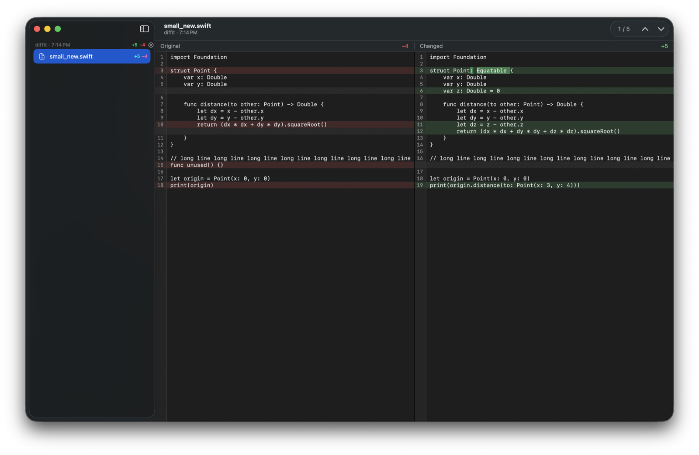
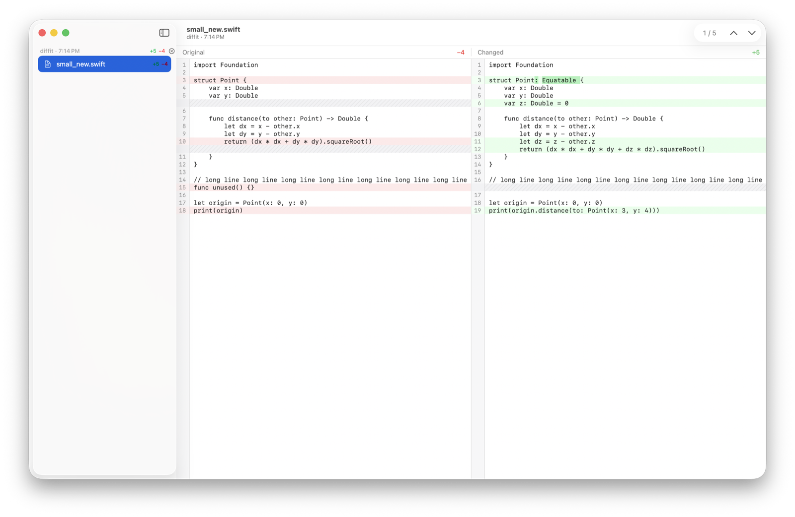

# DiffIt

A native macOS `git difftool` for reading code changes, especially the ones an AI agent just made.

- `git difftool` hands every changed file to a tiny CLI that returns in a few milliseconds; the app collects them all into one window with a file tree.
- Original on the left, changed on the right, aligned row by row, with full-width red/green tints and word-level highlights.
- The working-tree side is watched: save in your editor (or let an agent keep editing) and the diff updates in place, keeping its scroll position.
- View only. Nothing in the app can write to your files.
- Swift, SwiftUI and AppKit. No Electron, no web views. macOS 26 or later.





## Install

Requires Xcode 26 (or the matching Command Line Tools) and macOS 26.

```sh
git clone <this repository> diffit
cd diffit
make install      # builds, assembles DiffIt.app in /Applications, symlinks ~/.local/bin/diffit
make git-config   # sets diff.tool, difftool.diffit.cmd and difftool.prompt in ~/.gitconfig
```

Make sure `~/.local/bin` is on your `PATH`. `make git-config` is equivalent to:

```sh
git config --global diff.tool diffit
git config --global difftool.diffit.cmd 'diffit "$LOCAL" "$REMOTE" "$MERGED"'
git config --global difftool.prompt false
```

To undo it: `git config --global --unset diff.tool`.

## Use

```sh
git difftool                 # working tree vs index, every file in one window
git difftool --cached        # index vs HEAD
git difftool main...HEAD     # a branch's changes
git difftool -d              # directory mode also works
diffit OLD NEW               # compare two files without git
diffit /dev/null NEW         # an added file
```

Files opened by one `git difftool` run are grouped as a changeset in the sidebar. Close a changeset with the ⓧ in its header or ⇧⌘W. The app stays running after you close the window so the next `git difftool` opens instantly.

### Keyboard

| Action | Keys |
|---|---|
| Next / previous change | ⌘↓ / ⌘↑ |
| Next / previous file | ⌥⌘↓ / ⌥⌘↑ |
| Bigger / smaller text | ⌘+ / ⌘− |
| Toggle sidebar | ⌃⌘S |
| Reload the selected file | ⌘R |
| Reveal the working-tree file in Finder | ⇧⌘R |
| Open the working-tree file in its default editor | ⇧⌘O |
| Close changeset | ⇧⌘W |
| Settings (font, size, tab width, highlights) | ⌘, |

Vertical scrolling is synchronised between the panes; horizontal scrolling is independent. Text in both panes is selectable and searchable with the standard Find bar.

## How it works

- `diffit` (the CLI) copies git's temporary `$LOCAL`/`$REMOTE` files into `~/Library/Caches/DiffIt` (git deletes them as soon as the CLI exits), references the working-tree file in place, and sends one JSON message over a Unix socket in `~/Library/Application Support/DiffIt`. If the app is not running it launches it.
- The app diffs with a patience algorithm (Myers fallback) in `DiffCore`, builds side-by-side rows, and refines modified lines at the word level.
- Each pane is an `NSTextView` with every row pinned to the same height, so row alignment and scroll sync are plain arithmetic. 50 000-line files open in well under a second.
- A kqueue watcher per working-tree file reloads the diff on write, atomic save, or rename.

## Build from source

```sh
swift build          # debug build of the app and the CLI
make test            # unit tests (Swift Testing)
make app             # assemble build/DiffIt.app
make run             # launch it
```

Layout: `Sources/DiffCore` (diff engine, no AppKit), `Sources/DiffItProtocol` (socket messages), `Sources/diffit` (CLI), `Sources/DiffItApp` (app), `Tests/`.

## Not in v1

Editing or merging, three-way diffs, syntax highlighting, soft wrap, image diffs.
